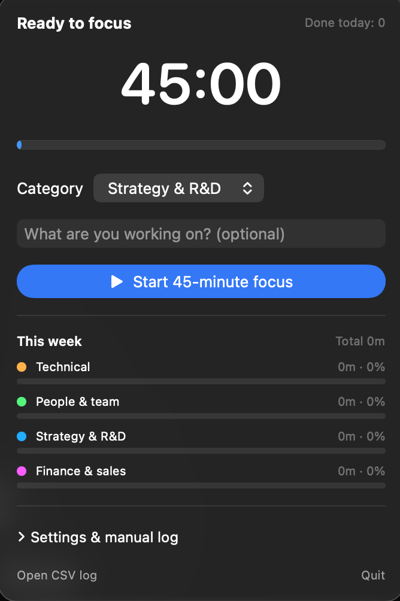

# Fokus

A small, free Pomodoro timer for the macOS menu bar that also shows where your week went.



## Features

- **Menu bar timer.** Focus and break phases with a countdown in the menu bar. Defaults to 45 minutes of focus, 10-minute breaks, and a 20-minute long break every 3 sessions. All of it is adjustable.
- **Categories.** Tag each session as Technical, People & team, Strategy & R&D, or Finance & sales.
- **Weekly summary.** Minutes and share per category for the current week (Monday to Sunday).
- **Technical-time target.** Optional limit on the share of technical work, with a warning when you go over.
- **Manual log.** Add time you spent without the timer, such as a meeting.
- **Notifications.** A sound and a notification when a focus session or a break ends.
- **Two languages.** Bahasa Indonesia and English, or follow the macOS language.
- **Local data.** Sessions are saved to a CSV file on your Mac. Nothing leaves your computer.
- **Open at login.** One checkbox in the settings.

## Requirements

- macOS 13 Ventura or later
- Xcode or the Xcode Command Line Tools (for `swiftc`)

## Build and install

```bash
git clone https://github.com/tomoeisozaki/fokus.git
cd fokus
./build.sh
```

`build.sh` compiles `main.swift` with `swiftc`, signs the app ad hoc, copies it to `/Applications`, and opens it. There is no Xcode project. Look for the timer icon in the menu bar.

The first time a session ends, macOS asks whether Fokus may send notifications. Allow it to get the alerts.

## Your data

Sessions are appended to:

```
~/Library/Application Support/Fokus/sesi.csv
```

Columns: `start, end, minutes, category, note, status`. Status is `completed`, `stopped` (ended early, logged when it ran at least one minute), or `manual`. Use **Open CSV log** in the app to find the file and open it in Numbers or Excel.

## Target schedule (optional)

To have the technical-time target change by date, set a schedule. The latest entry on or before today applies:

```bash
defaults write com.recovdot.fokus targetSchedule -array "2026-11-02=70" "2026-11-30=50" "2026-12-28=20"
```

Restart Fokus after changing it. To go back to the manual setting:

```bash
defaults delete com.recovdot.fokus targetSchedule
```

## Uninstall

Quit Fokus from its menu, then delete `/Applications/Fokus.app`. Your log stays in `~/Library/Application Support/Fokus` until you delete that folder.

## License

[MIT](LICENSE)

---

## Bahasa Indonesia

Fokus adalah timer Pomodoro gratis untuk menu bar macOS yang sekaligus menunjukkan ke mana waktumu habis setiap minggu.

- Timer fokus dan istirahat di menu bar (bawaan 45/10 menit, istirahat panjang 20 menit tiap 3 sesi, semuanya bisa diubah).
- Setiap sesi diberi kategori: Teknis, Orang/Tim, Strategi & R&D, atau Keuangan & Penjualan.
- Ringkasan mingguan per kategori, plus target porsi teknis (opsional).
- Catat manual untuk waktu tanpa timer, misalnya rapat.
- Bahasa Indonesia dan English. Ganti di **Pengaturan & catat manual → Bahasa**.
- Data tersimpan sebagai file CSV di Mac-mu sendiri.

**Cara pasang:** clone repo ini, lalu jalankan `./build.sh`. Butuh macOS 13 ke atas dan Xcode atau Command Line Tools.
